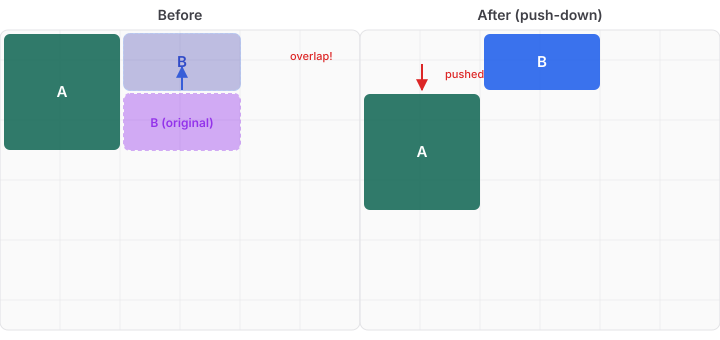
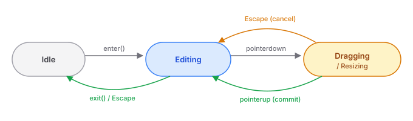

# Grid Editing Without a Framework

Most layout editors reach for a library. Gridstack.js, React-Grid-Layout, Muuri — pick your flavour. They handle the hard parts: pointer capture, ghost previews, collision resolution, snap-to-cell. You wire them up, style them to match, and ship.

We didn't use any of them.

CaseHub Pages already has its own rendering pipeline. Components are described in YAML, parsed into a typed model, and rendered to DOM by a pure function. The grid is CSS Grid — `repeat(12, 1fr)` with explicit `grid-column` and `grid-row` placement. Bringing in a layout library would mean running two layout systems side by side: CSS Grid for rendering, and whatever the library uses for editing. Every drag operation would need to reconcile between them. That's the kind of impedance mismatch that works fine in demos and breaks in production.

So we built grid editing from the ground up, directly against CSS Grid's coordinate system.

## Two Layout Systems, One Framework

Pages has two ways to lay out content. The original system — `columns` with `distribution: [4, 8]` and nested `rows` — is declarative and responsive. The proportions adapt to any viewport width. You can't span columns, but you rarely need to: content flows naturally within each column.

The new system uses explicit grid placement: `{mode: positioned, x: 0, y: 0, w: 6, h: 2}`. Every item has coordinates on a 12-column grid. This gives you arbitrary row and column spanning — a 4×3 panel next to an 8×1 banner next to a stack of 2×1 tiles.

Both coexist. The proportional system handles responsive content layouts. The positioned system handles spatial layouts where precise placement matters. Drag-and-drop editing applies to the positioned system only — because it has coordinates to drag.

## The Collision Problem

The interesting part isn't the pointer events or the ghost preview — those are mechanical. The interesting part is what happens when you drop a panel on top of another panel.



Gridstack.js and React-Grid-Layout both solve this with displacement algorithms. We studied both and landed on push-down: when a dragged item overlaps an existing item, the existing item shifts down by the minimum amount needed. Items never move sideways. A single pass, sorted by Y coordinate, resolves cascading overlaps — if pushing B down causes it to overlap C, C shifts down too.

The subtlety is backward overlap. If you drag an item upward into a position that overlaps an item with a *lower* Y coordinate, a naive forward pass misses it — the overlapped item sorts before the dragged one and is never checked. The fix is a pre-pass: check every item against the moved item first, push down any that overlap, then run the cascade pass for transitive effects.

The algorithm is a pure function — it takes an array of placements and returns a new array. No DOM, no side effects. This means the entire collision logic is tested without a browser:

```typescript
function resolveCollisions(
  items: readonly IdentifiedPlacement[],
  movedId: string,
  newPlacement: PositionedPlacement,
): IdentifiedPlacement[]
```

Eight unit tests cover the core cases: no overlap, single push-down, backward overlap, cascade, edge-adjacent (touching but not overlapping), resize-caused overlap, non-overlapping columns, and idempotency.

## Snap, Don't Pixel-Track

Grid editing that tracks pixels is grid editing that fights the grid. The pointer gives you `clientX` and `clientY`. The grid gives you cell coordinates. The entire pointer event architecture converts between these two systems at the boundary and never mixes them.

`snapToCell` takes a pointer position and a `GridGeometry` (cell width, cell height, gap) and returns a `{x, y}` cell coordinate. All downstream operations — placement clamping, collision resolution, ghost positioning — work in cell coordinates. The DOM only re-enters the picture at the end, when `applyGridPlacement` sets `grid-column` and `grid-row` on the element.

The gap complicates things. CSS Grid's `gap` property creates visual space between cells but doesn't change the logical grid. A 12-column grid with 12px gap has effective cell widths of `(containerWidth - 11 * 12) / 12`, and each cell's pixel offset accounts for the cumulative gaps. Get this wrong and the ghost preview drifts from the grid lines.

## Edit Mode as a State Machine

The edit controller is a state machine with three states: idle, editing, and dragging. Enter edit mode and the grid gets a visible overlay of cell boundaries — faint lines rendered via `repeating-linear-gradient`, not actual DOM elements. Each positioned item becomes draggable (4 edges + 4 corners for resize). The content inside each item gets `pointer-events: none` so charts and tables don't intercept the drag.



One detail worth noting: only one grid can be in edit mode at a time. A module-level reference enforces mutual exclusion — entering edit mode on grid B automatically exits grid A. This prevents confusing interactions when a page has multiple grids.

The ghost preview during drag is *not* a CSS Grid child. Inserting a positioned element into the grid disrupts `grid-auto-flow` for any auto-placed items and creates implicit rows. The ghost is absolutely positioned within an overlay div, at pixel coordinates computed from the snapped cell position. It looks identical to a grid child but has zero layout side effects.

## What This Unlocks

Grid editing on its own is visual-only — you drag, you resize, you see the result, and the controller dispatches a `pages-grid-edit` event with the updated placements. No YAML mutation, no undo/redo. That's deliberate.

The next layer — already scoped as a separate issue — wires this into the PageDocument model. Every drag becomes a YAML CST mutation. Multiple displaced items in a single drop become a compound transaction for undo. The format conversion from `components:`/`rows:` to `items:` triggers on the first drag operation.

By keeping the visual layer independent of the document layer, each can be tested, iterated, and debugged on its own terms. The collision algorithm doesn't need to know about YAML. The document model doesn't need to know about pointer events. The boundary between them is a single event carrying an array of placements.

That boundary is the entire point.
