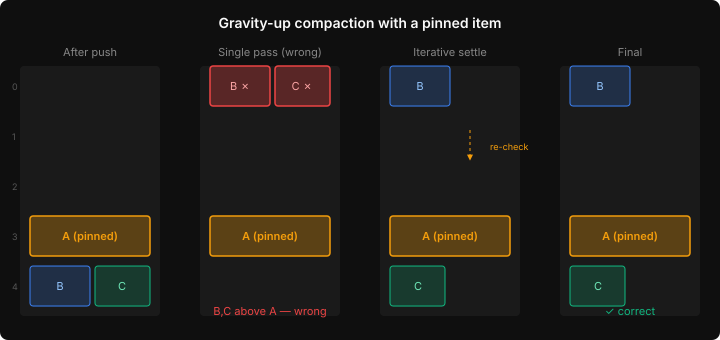
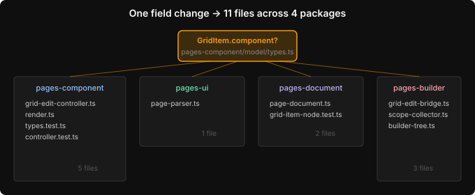

# Integers, Not Pixels: Building a Grid Compaction Engine Without a Browser

The POC proved the grid layout model works. Drag panels around, they compact upward, row breaks act as gravity boundaries. All in a single HTML file with inline JavaScript. The next step is turning that into production code — and the first question is: how much of this needs a browser?

The answer, it turns out, is almost none.

## The compaction problem is arithmetic

A grid compaction algorithm does three things. Place the dragged item at its target position. Push anything it overlaps below it. Then compact everything upward to fill gaps — gravity pulling items to the top.

Every one of these operations works on `{x, y, w, h}` tuples. Integer coordinates on a 12-column grid. Overlap detection is four comparisons:

```typescript
function overlaps(a: Rect, b: Rect): boolean {
  return a.x < b.x + b.w
    && a.x + a.w > b.x
    && a.y < b.y + b.h
    && a.y + a.h > b.y;
}
```

No DOM. No `getBoundingClientRect()`. No CSS. The browser is only involved later, when `grid-column` and `grid-row` translate these integers into visual positions. The compaction itself is a pure function: items in, items out.

This matters because pure functions are testable without infrastructure. I can throw 30 test cases at the compaction engine — spanning items, cascading pushes, side-by-side compaction, idempotency checks — and get a full run in under 10 milliseconds. No headless browser, no JSDOM, no test fixtures. Just integers.

## The settling bug

The first implementation of `compact` used a single pass. Sort items by `y`, then for each item, find the lowest `y` where it doesn't overlap anything already placed.

It works for simple cases. It fails when a pinned item sits in the middle of the grid.

When you drag item A from row 0 down to row 3, A gets pinned there. The compaction pass processes items top-to-bottom. Item B, originally at row 5 (pushed below A), checks row 0 — no overlap with anything — and moves there. Geometrically valid. Visually wrong.



The problem is subtler than it looks. B at row 0 is a 6-wide item. A at row 3 is also 6-wide. They don't overlap because their y-ranges don't intersect ([0,2) and [3,5)). So the single-pass algorithm puts B at row 0 — above the item the user just dragged there.

But then C checks row 0, finds B there, moves to row 2. Row 2 is `{y:2, h:2}` — range [2,4). A is at row 3 — range [3,5). They overlap. C should move to row 5. But the single-pass loop already checked A and moved on. It doesn't re-check.

The fix is iterative settling. After each `bestY` update, re-scan all placed items:

```typescript
let bestY = 0;
let settled = false;
while (!settled) {
  settled = true;
  for (const placed of result) {
    if (overlaps({ ...item, y: bestY }, placed)) {
      const newY = placed.y + placed.h;
      if (newY > bestY) {
        bestY = newY;
        settled = false;
      }
    }
  }
}
```

The `while` loop re-scans until no placed item forces a further adjustment. For typical grids (5-20 items), this converges in 2-3 iterations. The cost is negligible — we're comparing a handful of rectangles, not rendering pixels.

I only found this because the test case for `compactAll` exercised a three-item grid with the moved item landing in the middle. The single-pass version passed all the simpler tests. Without a test that specifically checked gravity-up behaviour around a pinned item, this would have shipped as a subtle drag-and-drop glitch — items occasionally teleporting to unexpected positions.

## One field, eleven files

The unified grid model needs empty containers. A `GridItem` with no component — just a placement, waiting for content. In the type system, this means making `component` optional:

```typescript
interface GridItem {
  readonly placement: GridPlacement;
  readonly component?: Component;  // was required
}
```

One character change. Question mark after `component`. The TypeScript compiler then walks you through every file that accesses `item.component` without a guard.



Eleven files across four packages: the renderer that draws grid items, the controller that handles drag events, the parser that reads YAML, the document model that exposes nodes, the edit bridge that translates events into mutations, the scope collector that gathers components for autocomplete, the tree view that renders the hierarchy. Every one of them assumed `component` was always present.

The type system found all eleven. That's the deal with TypeScript — you pay the propagation cost once, up front, instead of discovering each missing guard as a runtime crash in production. For a change like this, where an interface contract shifts across package boundaries, the compiler is doing exactly the work you'd otherwise do by hand, badly.

The renderer got the most interesting change. Where it used to call `renderNode(el, item.component, ...)` unconditionally, it now checks:

```typescript
if (!item.component) {
  const empty = document.createElement("div");
  empty.className = "pages-empty-container";
  el.appendChild(empty);
} else if (item.placement.mode === "positioned") {
  renderNode(el, item.component, ...);
}
```

Empty containers are first-class. They participate in the CSS Grid. They have placement. They just don't have content yet — that's the job of the layout mode editor, which assigns components to containers by dragging from the palette.

## Why this matters for app builders

Most grid layout editors are built on Gridstack or React-Grid-Layout. These are fine tools, but they impose a translation layer: your application's model goes in, the framework's internal representation does the layout math, and the visual result comes out. When something goes wrong — a panel lands in the wrong position, compaction produces an unexpected layout — you're debugging through the framework's internal state.

Building compaction as pure functions on your own model eliminates the translation. The same `{x, y, w, h}` tuples that live in the YAML file are the ones the compaction algorithm operates on. The same tuples that CSS Grid renders. There is no intermediate representation. The model is the code.

This is the foundation for the two-mode editor. Layout mode creates the grid skeleton — split, merge, resize, swap. Content mode fills containers with components — drag, displace, push. Both modes operate on the same model. Both use the same compaction engine. The mode is just a behavioural switch on what happens when you drop.

Five modules, all pure functions except the overlay: compaction, selection, split/merge, collision detection, auto-shrink. The controller and bridge come next — those need the DOM. But the hard part, the part where subtle bugs hide, is already tested and correct. Because it's integers, not pixels.
