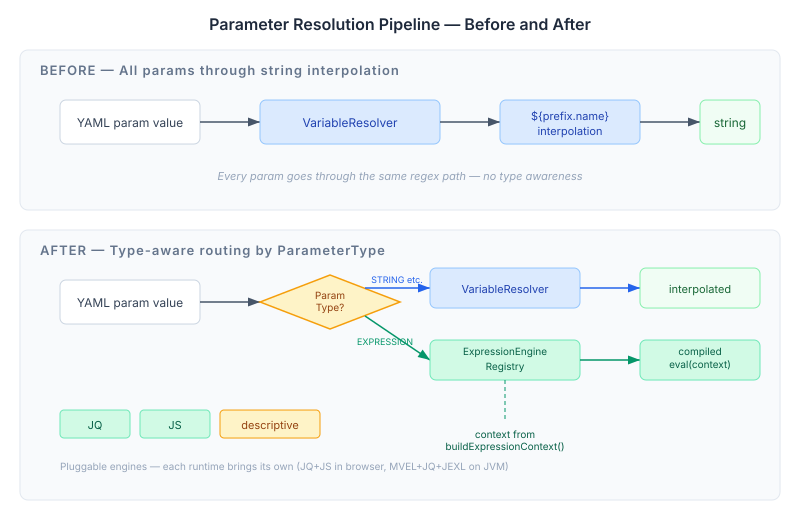

# When Parameters Stop Being Strings

The CaseHub playbook runtime has had six parameter types since the beginning: STRING, INTEGER, NUMBER, BOOLEAN, ARRAY, OBJECT. Every one of them flows through the same resolution path — `VariableResolver.resolveMap()` does a regex pass over `${prefix.name}` tokens and returns interpolated strings. It doesn't matter whether the plugin declared its parameter as a boolean or an array. The resolver treats everything as text with holes in it.

This worked because interpolation is universal. You can substitute `${env.host}` into any string and get a string back. But it breaks down the moment you need the result of an evaluation, not a substitution. `.items | length` is not a string with a variable in it — it's a program. It takes structured input, executes a computation, and returns a typed result. Interpolation has nothing to offer here.

## The Seventh Type

Java's `yaml-plugin-api` already has `ParameterType.EXPRESSION` as a seventh enum value, and the pipeline to go with it — `TypeAwareParamResolver` checks parameter types and routes EXPRESSION params through `ExpressionEngineRegistry` instead of `VariableResolver`. The TypeScript runtime had none of this. Every param went through the same regex, the same `${}` pattern, the same string output.

The fix is a parallel resolution path. When `evaluatePlugin()` encounters a step, it now checks whether any of the plugin's declared inputs have `type: EXPRESSION`. If they do, it splits the params: strings go through `VariableResolver.resolveMap()` as before, expressions go through `ExpressionEngineRegistry.compile()` → `CompiledExpression.eval(context)`. The two paths converge into a single resolved parameter map before the decorator chain sees it. Plugins that don't use EXPRESSION params take the fast path — the check is a single `Object.values(inputs).some()` call that returns false immediately.

The choke point in `StructuralEvaluator.evaluatePlugin()` went from one line to a conditional, but the existing path is unchanged. No plugin breaks. No YAML changes.

## Engines Are Runtime-Specific — The Contract Is Not

The interesting design problem was engines. Java has three: MVEL for conditions, JQ for data transforms, JEXL as a general-purpose fallback. None of these run in a browser. MVEL compiles against JVM bytecode. JEXL depends on `java.lang.reflect`. JQ's canonical implementation is C.

The temptation was to port them. I didn't. The engine interface is what needs parity — `ExpressionEngine` with `type`, `compile(expression)`, and `validate(expression)`. Each runtime brings its own implementations. TypeScript gets two: a JQ engine wrapping `@sscots/jqjs` (a pure JS implementation at 76 kB — it compiles JQ expressions to generator functions, which maps cleanly to `CompiledExpression.eval()`), and a JS engine that uses `new Function` with a null-prototype context for simple boolean conditions and arithmetic.

The default mappings tell the registry which engine handles which context:

| Context | TypeScript | Java |
|---------|-----------|------|
| CONDITION | js | mvel |
| TRANSFORM | jq | jq |
| FILTER | jq | jq |
| PARAMETER | js | mvel |

JQ is the same on both sides for data transforms — that's where the language genuinely matters. For conditions and parameter expressions, each runtime uses its native scripting language. The YAML is portable; the evaluation isn't, and it doesn't need to be.

## Dual-Registration

The second piece was getting expression context to the engines. `VariableResolver` is immutable and prefix-based — you push scopes onto it with `withScope('vars', source)` and resolve with `${vars.name}`. Expressions need the same data but as a flat context map, not a prefix-lookup function.

The solution was to add a parallel container system. `withExpressionContext('env', { host: 'localhost' })` stores the map in `scopeContainers` alongside the existing `prefixSources`. `buildExpressionContext()` aggregates them into `{ env: { host: 'localhost' } }` — the context map that `CompiledExpression.eval()` receives. The immutable copy-on-write pattern carries through: every `withExpressionContext` call returns a new resolver, the same way `withScope` always has.

The `withObjectScope` overload is where dual-registration happens. When you pass a plain `Record<string, unknown>` instead of an `ObjectVariableSource`, the resolver adds it to both `objectSources` (wrapped as a resolve function for `${prefix.name}` interpolation) and `scopeContainers` (raw, for expression context). One call, both paths available. Scopes pushed this way are automatically usable by both string interpolation and expression evaluation.

## The Descriptive Fallback

When a playbook references an engine that isn't registered — say, a Java-authored playbook using MVEL rendered in the browser — the registry doesn't throw. It returns a `DescriptiveExpression` whose `eval()` produces a structured description: the engine name, the expression text, the context, and a `not-available` status. The browser can render this as "this step would evaluate `itemCount > 0` via MVEL, but MVEL isn't available in this runtime" instead of crashing the preview.

Java does throw — `IllegalArgumentException` from `DefaultExpressionEngineRegistry.resolveEngine()`. The divergence is deliberate. Java playbooks execute for real; an unregistered engine means a misconfigured system and should fail loudly. Browser playbooks preview for understanding; an unregistered engine means the runtime doesn't support this feature, and showing what would happen is more useful than a stack trace.

## What This Opens

The expression system is infrastructure. It doesn't do anything visible by itself — no user-facing feature ships with this change. What it does is remove the ceiling. Plugin authors can now declare parameters as expressions and get compiled evaluation instead of string interpolation. The assert plugin can evaluate `${data.count > threshold}` as a real boolean instead of string-comparing `"true"`. Transform steps can pipe data through JQ filters and get structured results. Condition decorators can evaluate complex boolean expressions without routing through a special-case condition evaluator.

The next phases — agent session handlers (#642) and step-viewer visual polish (#643) — are independent of this and can run in parallel. The expression system sits underneath, ready when the first plugin author declares `type: EXPRESSION` on a parameter. 
