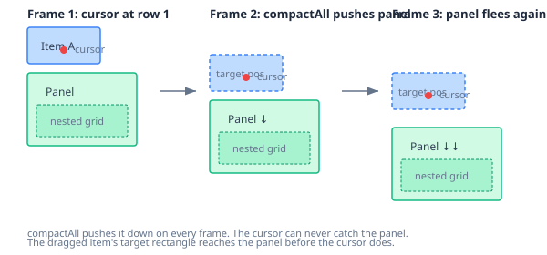
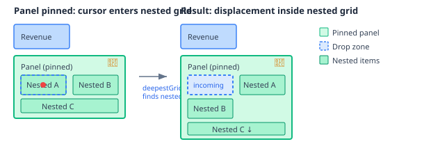

# When Grids Contain Grids: Cross-Grid Drag-and-Drop for Nested Layouts

A grid layout engine that handles drag, resize, and compaction within a single grid is table stakes. Every dashboard builder does this. The interesting question is: what happens when a grid item *contains* another grid?

A panel with a form section inside it. A dashboard section holding a sub-dashboard. A page section containing a widget group. These are all the same structure: a grid item that is itself a grid container. And the moment you try to drag an item *between* those grids — from the nested grid to the parent, or from the parent into the nested grid — the interaction model breaks in ways that are genuinely difficult.

## The compaction chasing problem

Within a single grid, displacement is straightforward. The dragged item's target rectangle is placed at the cursor position. `compactAll` pushes overlapping items down, then gravity-compacts everything upward. A placeholder shows where the item will land. Other items slide out of the way with FLIP animation. Clean, predictable.

Cross-grid drag adds a wrinkle: the grids have different column counts, different cell sizes, and different coordinate systems. A 3-column-wide item in a 6-column nested grid becomes 6 columns wide in a 12-column parent grid. The coordinator handles this with proportional scaling — `scaleWidth(sourceW, sourceColumns, targetColumns)`.

But the real problem is subtler.



When I drag a parent item toward a panel that contains a nested grid, the compaction algorithm pushes the panel out of the way. The dragged item's target rectangle — not the cursor, the *item rectangle* — reaches the panel before the cursor does. The item is 4 columns wide and 2 rows tall. When the cursor is at row 1, the item's bottom edge is already at row 2, overlapping the panel at row 2. `compactAll` pushes the panel down to row 4. Next frame, the cursor reaches row 2 — but the panel is now at row 4. The target rectangle reaches row 4, and the panel gets pushed to row 6.

The cursor chases a target that runs away on every frame. You can never reach the nested grid.

This is not a bug in the compaction algorithm. `compactAll` is doing exactly what it should — keeping items from overlapping. The problem is that the displacement model, which works perfectly within a single grid, creates an impossible interaction when the user's intent is to *enter* a grid container rather than push it aside.

## What the industry does

I looked at how established tools handle this.

**GridStack.js** uses a dwell-based approach. Drag fast over a container and it displaces. Pause over it for a duration and you enter it. The pause is the signal that distinguishes "passing through" from "going in."

**Figma** auto-nests by default — dragging over a frame enters it. Hold spacebar to prevent nesting and move the frame instead. Users frequently complain this is unintuitive, and there's a popular feature request to invert the default.

**React-Grid-Layout** doesn't support nested grids at all. Multiple community forks exist; none have solved the enter-vs-displace problem cleanly.

**WordPress Gutenberg** has ongoing work to make nested block drops reliable. Their own contributors describe distinguishing "drop at end of a group's inner blocks" from "drop after the group" as a known UX gap.

Most editors either avoid nesting or handle it poorly. We're in novel territory.

## Why dwell doesn't work here

I initially implemented GridStack's dwell approach: pin the panel temporarily when the cursor enters it, start a 500ms timer, enter the nested grid if the timer completes, displace normally if the cursor leaves before it fires.

It doesn't work for our case, and the reason is fundamental. Displacement is item-position-based, not cursor-position-based. The *item's target rectangle* overlaps the panel before the cursor physically reaches it. A dwell timer keyed to cursor position is checking the wrong thing — the displacement happens in item-rectangle space, but the dwell checks cursor space. By the time the cursor is over the panel, the item target already pushed it away several frames ago.

This is a category error. You can't use a cursor-based signal to control item-position-based behaviour.

## The solution: pinned panels

The fix is to step outside the compaction model entirely for items that contain nested grids. Panels with nested grids are **pinned** — `compactAll` skips them. They don't participate in displacement. They stay where they are.



This solves the chasing problem at the root. The panel doesn't flee because `compactAll` doesn't touch it. Other items compact around the pinned panel as if it were a fixed obstacle. The cursor naturally reaches the panel's area, `deepestGridAt` finds the nested grid controller, cross-grid mode activates, and the displacement preview shows *inside* the nested grid — items pushing down to make room for the incoming item.

The implementation extends `compactAll`, `push`, and `compact` with an optional `pinnedIds` parameter. Pinned items are treated like the moved item in `compact` — they stay at their current position, and other items flow around them.

```typescript
export function compactAll(
  items: readonly IdRect[],
  movedId: string,
  target: Rect,
  pinnedIds?: ReadonlySet<string>,
): IdRect[] {
  const placed = place(items, movedId, target);
  const pushed = push(placed, movedId, pinnedIds);
  return compact(pushed, movedId, pinnedIds);
}
```

Three lines of interface change. The compaction engine gained nesting awareness without any structural modification.

## The pin toggle

Default pinning handles the common case — you can drag items into and out of nested grids without the panel running away. But sometimes you *want* to displace a panel. Reorder the parent grid. Move the panel itself to a different position.

A small toggle (📌/📍) on panels with nested grids lets the user switch. Pinned panels can't be displaced; unpinned panels behave like regular items. The state lives on the coordinator singleton, not the controller instance, so it survives preview re-renders.

For reordering pinned panels, swap mode (⇄) works — it exchanges positions directly without compaction.

## What this unlocks

The practical significance is not about dashboards. Any system that composes pages from sections, and sections from components, needs nested containers. A form builder where form sections contain field groups. A page builder where panels contain sub-layouts. An app builder where any component can be a container.

Cross-grid drag-and-drop is the interaction that makes these containers *composable* — not just nestable, but rearrangeable across nesting levels by direct manipulation. The user drags a field from one form section to another. Drags a widget from a sub-panel to the main layout. The YAML updates atomically, the preview re-renders, and the item lands where they dropped it with compaction handling the rest.

The pinning model means nested containers don't interfere with the displacement system that makes drag-and-drop fluid for regular items. Two rules that compose: pinned items are fixed obstacles, everything else compacts.

Grid editing is the foundation for a universal WYSIWYG page composition system. The compaction engine, the cross-grid coordinator, and the pinning model are the three pieces that make nesting work.
